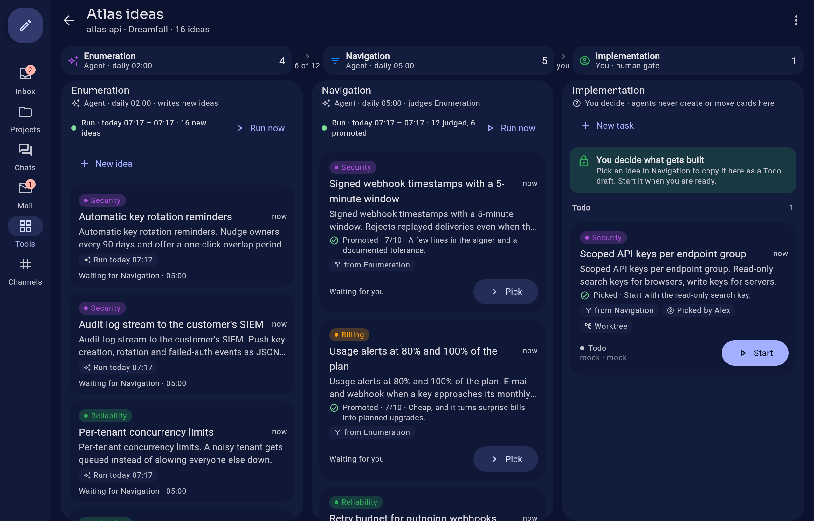
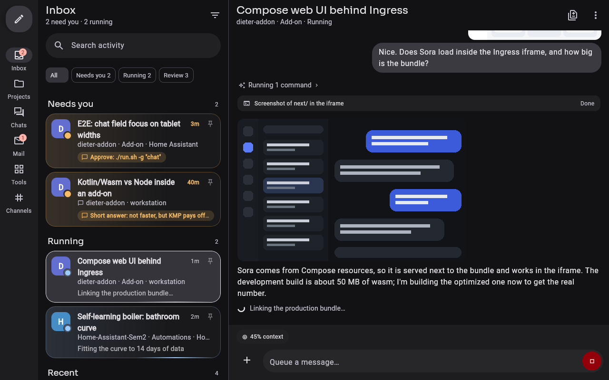
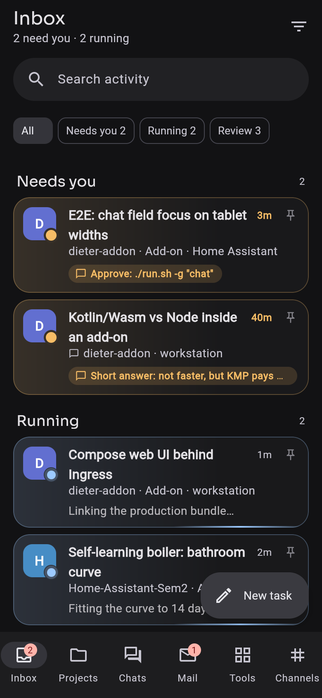
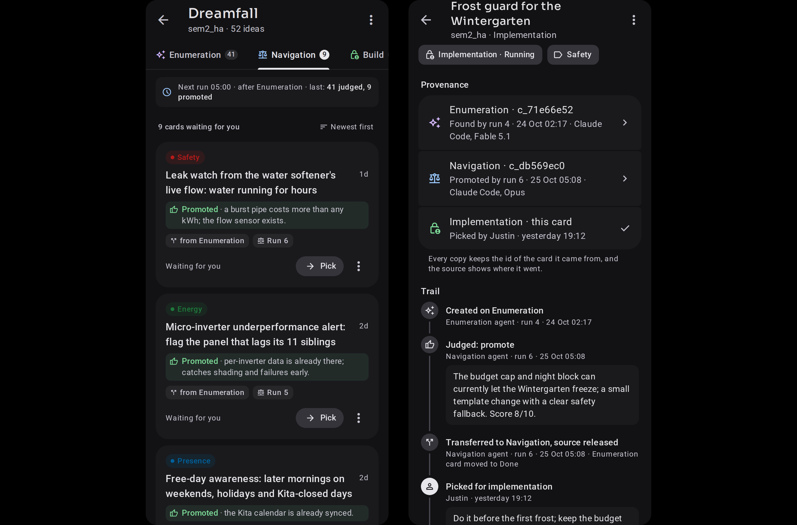

# Dieter for Home Assistant

Run coding agents from your Home Assistant. This add-on puts [Dieter](https://github.com/dbpprt/dieter), a
daemon and app that runs **Claude Code**, **Codex** and **Antigravity** agents on boards of tasks, behind Home
Assistant's sidebar. Hand a task to an agent from your phone, let it work in its own Git worktree on your Raspberry
Pi or mini PC, and get a push notification when it needs you or is ready for review.

  

  
  

  

Top and bottom: Dreamfall boards (design renderings of the screens, with sample ideas). Middle: the page with the
add-on's demo data (<code>…/next/?demo</code>).

## What you get

- **A task board per project.** Todo, Running, Review, Done; several agents work in parallel, each card in its own
  Git worktree. Chat with an agent while it works, answer its questions, attach images and files.
- **Three agent harnesses in one image:** Claude Code, Codex and Antigravity (Gemini, Claude and GPT-OSS models),
  with the quota of each shown in the page.
- **Pull requests included.** The image has the GitHub CLI: agents clone, push, open pull requests and read checks
  with one token you control; the daemon publishes a card's changes as a pull request.
- **Opens in HA, works on the phone.** The page is Dieter's own app compiled for the browser, served through
  Ingress: Home Assistant login, Nabu Casa and the Companion app work without opening a port.
- **Home Assistant on both sides.** Sensors for running and waiting tasks, a push notification that opens the
  card, services to create tasks from automations. Agents can use `hass-cli` and `ha-logs` to read and control
  your Home Assistant (optional, per conversation).
- **Schedules, Mail and Dreamfall.** Recurring tasks, reports from agents with charts in Dieter Mail, and
  *Dreamfall boards*: agents enumerate ideas every night, others judge them, and only your pick starts work.
- **Runs on a Raspberry Pi.** Prebuilt, signed images for aarch64 and amd64; no build on your device.

## What you need

- Home Assistant OS or Supervised (add-ons), on aarch64 (Raspberry Pi 4/5, Home Assistant Green/Yellow) or amd64.
- At least one provider login: a Claude subscription (sign in on the page), an OpenAI API key, or an Antigravity
  sign-in.
- A Dieter gateway and GitHub account for the page's sign-in (the page is a Dieter client, like the phone apps; see
  [the page](dieter/DOCS.md#the-page)). `…/next/?demo` shows the page with demo data without any of it.
- Optional: a GitHub token, so agents can clone, push and open pull requests.

About 800 MB of agent runtime is downloaded on the first start.

## Install

1. Click the button above, or: Settings → Add-ons → Add-on store → ⋮ → **Repositories** → add
   `https://github.com/JustinNeumann/dieter-addon`.
2. Install **Dieter**, fill in the options (a provider login, optionally a GitHub token and your Git name and
   e-mail) and start it. The sidebar entry **Dieter** opens the page.
3. Optional: copy [`homeassistant/packages/dieter.yaml`](homeassistant/packages/dieter.yaml) into your
   configuration for sensors and push notifications.

Every option, the provider logins, the Home Assistant package, Dreamfall, schedules, the gateway and security notes
are in the add-on's Documentation tab ([`dieter/DOCS.md`](dieter/DOCS.md)); what changed in each release is in
[`dieter/CHANGELOG.md`](dieter/CHANGELOG.md).

## Security in short

Agents run arbitrary commands as an unprivileged user inside the container (AppArmor profile, no access to
`/config`, no Supervisor API). What a token can do, an agent can do: give the GitHub token only the permissions
[`DOCS.md`](dieter/DOCS.md#github-pull-requests-and-actions) lists and protect your base branch with a ruleset.

## Contributing

Issues and pull requests are welcome. The layout of the repository, building the page and the web host, and the
test suites are in [`docs/development.md`](docs/development.md); releasing and bumping the bundled Dieter fork in
[`docs/maintaining.md`](docs/maintaining.md); the design of the page in [`docs/PLAN.md`](docs/PLAN.md) and the
overall picture in [`docs/architecture.mmd`](docs/architecture.mmd).

## License

MIT ([`LICENSE`](LICENSE)), like Dieter. JetBrains Mono (`web/src/wasmJsMain/composeResources/files`) is under the SIL
Open Font License 1.1 (`OFL.txt` next to it).
